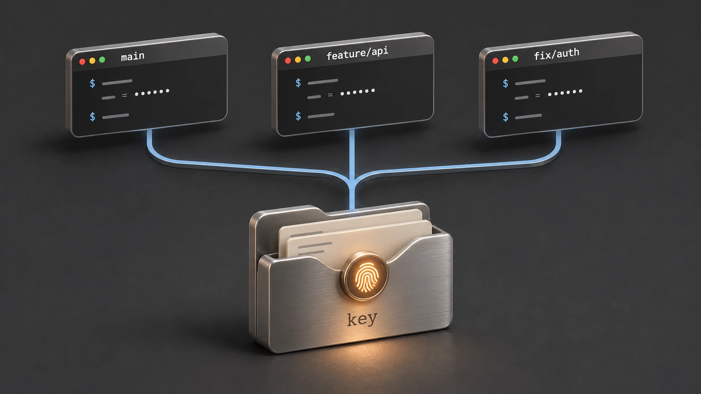

While passkeys and passwordless tech continue to [make real progress](https://securityboulevard.com/2026/03/passkeys-hit-critical-mass-microsoft-auto-enables-for-millions-87-of-companies-deploy-as-passwords-near-end-of-life/), passwords are still widely prevalent, and there is a broad surface of authentication that doesn't map to passkeys: API keys, OAuth client secrets, TOTP seeds, recovery codes, and SSH private keys. And with everyone trying their hand at building things these days, without discipline and strong tools you end up with credentials scattered all over the place.

## Where I Started

I was an early LastPass user at the time they were considered one of the stronger players in the space. But when Apple added Passwords as a dedicated app in macOS Sequoia and iOS 18, I switched — it's genuinely the best experience I've found. Safari's autofill is the most responsive and reliable implementation I've encountered. `userPresence` makes it that much better: on a MacBook that resolves to Touch ID, or Apple Watch if you're wearing one, or your system password as a fallback, all handled by the OS transparently. I haven't seen anyone come close.

But outside Safari that smooth experience breaks down. Credentials and secrets are strewn across `.env` files on multiple machines, and I still can never find what I need when I need it. Trying to remember to store a secret back in the app — opening it, searching, copying — turns it back into friction and mess.

## Pass: The Right Idea, Wrong Unlock

More recently I stumbled across `pass`, the venerable Unix password manager. Each secret is its own file. No opaque database, no lock-in, a small composable command set. Its design and approach made complete sense to me.

But after my experience with `userPresence`, I just couldn't get on board with unlocking through the GPG agent in shell. What I couldn't stop wondering was: what would `pass` look like built natively for macOS?

## A Pattern I'd Seen Before

Working on [Frame](https://github.com/tvanreenen/frame) — a tiling window manager for macOS — I'd already worked through the architecture of a command-line interface talking to a bundled background process. I quickly felt I could apply the same pattern here. The CLI would stay thin. A helper process would hold the key material and do the sensitive work.

## Could I Actually Build This?

The real question wasn't whether I could build a new version of `pass` — it was whether I could nail a strong-but-smooth native auth experience. The requirements shaped up around that:

- Individual encrypted files, not a database, in a directory I own and easily manage
- Standard encryption I can audit and decrypt without the app if I need to
- Composable CLI that works with `fzf`, `pbcopy`, pipes, and shell scripts
- `userPresence` unlock — Touch ID, Apple Watch, or system password, resolved by the OS, with a warm session so you're not re-authenticating on every command

The result is `key`.

## How It Works

The architecture is three pieces.

**Key.app** gives the project a proper macOS identity — signing context, entitlements, the app bundle that everything else depends on. It registers the LaunchAgent helper on first launch and otherwise stays out of the way.

**The `key` CLI** is what you actually use: `get`, `copy`, `add`, `edit`, `list`, `rename`, `remove`, `unlock`, `lock`. It handles input and output. It does not touch the vault key directly.

**The LaunchAgent helper** is where the work happens. It's managed by `launchd` and communicates with the CLI over XPC — Apple's inter-process communication framework, using a named Mach service the OS brokers between processes. It owns Keychain access, enforces `userPresence`-gated vault key retrieval, handles encryption and decryption, and maintains a short-lived in-memory unlock session. Run `key unlock`, macOS prompts for auth, the helper warms a session, and subsequent commands reuse it until it idles out.

This split is the primary security boundary. Keychain access is gated by signing context and entitlements that only the helper carries — the CLI being a separate process is precisely what makes that possible.

The vault is straightforward: one randomly generated 256-bit symmetric key, stored in Keychain, encrypts all secrets individually as AES-256-GCM JSON files. Standard primitives, no custom cryptography. If you ever need to decrypt outside `key`, the README walks through it — parse the JSON, base64-decode the nonce and ciphertext, split the auth tag, decrypt with any AES-GCM implementation. The vault key is the only thing that needs protecting, and it lives in Keychain behind your biometrics.

Two side projects grew out of this: [xkcdpass](https://github.com/tvanreenen/xkcdpass) and [Making Sense of One-Time Passwords](/posts/totp-in-swift/).

## One Lesson Still In-Progress: The Multi-Device Security Model

The current security model is deliberately simple and deliberately local. The vault key is stored with `kSecAttrAccessibleWhenUnlockedThisDeviceOnly` — Apple documents this as non-migrating, meaning it won't sync to other devices even through iCloud Keychain. You can sync the encrypted `.secret` files wherever you want — the vault key to decrypt them stays local.

That's a narrow trust boundary by choice. Working through the options has been an interesting exercise in what you're actually trading off — security, trust, and UX don't always pull in the same direction. The way I've thought about it, each model makes a different bet:

**Local-only (current).** One vault key, one Mac, biometric auth, short-lived session. Files can be synced; the decrypt capability can't. A second Mac with the same files can't read them — the key isn't there.

**iCloud-syncable Keychain.** Flip `kSecAttrSynchronizable` on and the vault key follows your Apple ID across devices. Simplest portability story. But the trust boundary shifts from "this Mac" to "any device in your iCloud Keychain set," which is a meaningfully different thing.

**Explicit import/export.** Keep local-only as the default, add a deliberate export flow producing a passphrase-wrapped bundle. Portability only happens when you ask for it. The event is legible — you know the key left, you know what artifact exists, you control where it goes.

**Secure Enclave multi-device.** Each authorized Mac generates its own Secure Enclave-backed keypair. The shared vault key is wrapped separately to each device's public key. Nothing exportable moves. Strongest trust model, most complex to implement and recover from.

I'm still thinking through what this means for `key`. Local-only feels like the right default to hold. Explicit import/export is probably the right next step. But I'm genuinely intrigued by the Secure Enclave path — assuming I can find a UX that doesn't make key recovery a nightmare.

## Where It Is Today

`key` is on Homebrew, open source, and something I use daily. Biometric unlock, `key copy`, TOTP, a ZSH alias with `fzf` — it does what I need it to do, cleanly.

If you're on macOS and `pass` has ever appealed to you, take a look. Repo at [github.com/tvanreenen/key](https://github.com/tvanreenen/key), overview at [key.tvr.works](https://key.tvr.works).
